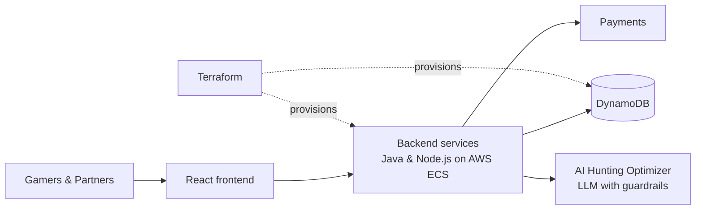

# GamerXPro: Architecture Case Study

**[gamerxpro.com](https://gamerxpro.com)** is a two-sided marketplace that connects gamers with vetted service partners. I designed, built and launched it in under 7 weeks (build started August 12, 2026).

> The product source code is private. This repository documents the architecture, key decisions and results. I'm happy to walk through the private codebase live in an interview.

## Results

| Metric | Value |
|---|---|
| Gamers | 156 |
| Approved partners | 27 |
| Hours booked | 250 |
| Average time from request to partner match | ~3 minutes (127 matches) |
| Time from first commit to launch | < 7 weeks |

## Architecture

- **Frontend:** React and TypeScript.
- **Backend:** Java and Node.js services running on AWS ECS.
- **Data:** DynamoDB.
- **Infrastructure as code:** all AWS resources are provisioned with Terraform, with automated deployment.
- **Marketplace flows:** partner vetting, matching, orders and payments.

## AI features

**Hunting Optimizer & Simulator:** simulates hunts and recommends the best decisions for the player's team.

Development-time guardrails:

- Prompt validation before model calls
- Output review before results reach users
- Controlled tool and code execution

AI-assisted development: I used Claude Code across the workflow, which is a large part of how the product went from idea to launch in under 7 weeks.

## Key decisions

| Decision | Why |
|---|---|
| Managed containers (ECS) instead of self-managed Kubernetes | A small team needs less operational overhead and faster deploys |
| DynamoDB | Predictable key-based access patterns for marketplace entities, with no servers to manage |
| Terraform from day one | Reproducible environments and safe changes as the product grows |
| AI with explicit guardrails | Keeps AI recommendations useful and safe for users |

## Stack

Java · Node.js · React · TypeScript · AWS (ECS, DynamoDB) · Terraform · Anthropic Claude · Claude Code

## About me

Rodrigo Reis, Senior Tech Lead & Full-Stack Engineer with 14 years of experience.
[LinkedIn](https://www.linkedin.com/in/rodrigo-santos-reis/) · [GitHub](https://github.com/drigores)
